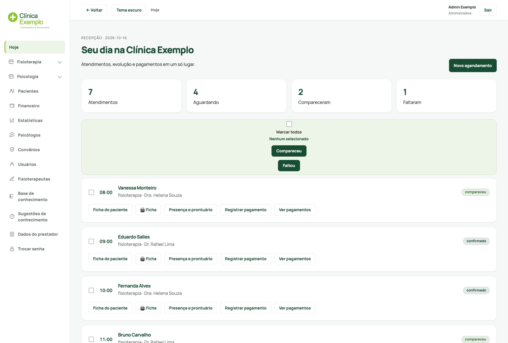
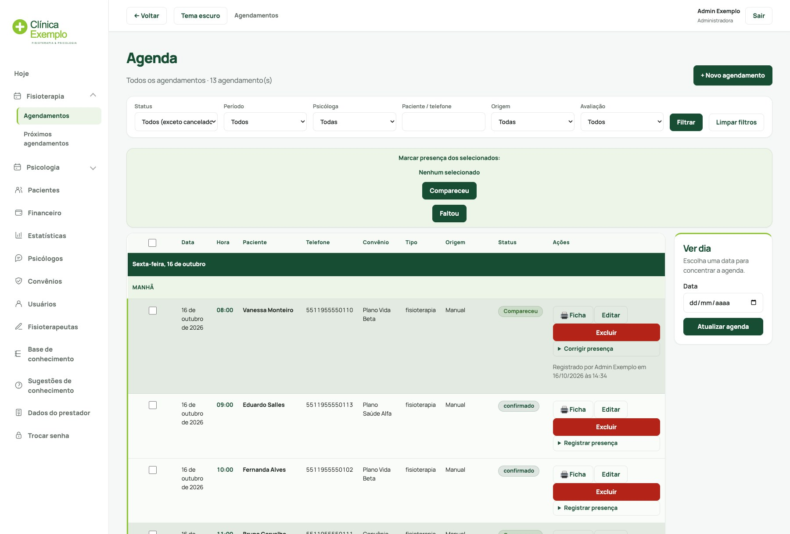

# Clínica Exemplo Bot

> **Projeto de portfólio.** Sistema construído para uma clínica real de fisioterapia e psicologia (bot de WhatsApp com IA, agenda, financeiro e TISS). O serviço foi desativado e todos os nomes, telefones e contatos neste repositório são fictícios.

MVP de agendamento via WhatsApp para a Clínica Exemplo (fisioterapia e psicologia). O paciente conversa naturalmente pelo WhatsApp; um agente de IA (GPT-4o mini com function calling) conduz o atendimento, consulta a disponibilidade real no Postgres e confirma o agendamento — sem app, sem site.

> Este README é para quem desenvolve/mantém o projeto. Para uso do dia a dia da clínica (como conferir se está funcionando, ver agendamentos, o que fazer se algo der errado), veja [`OPERACAO.md`](./OPERACAO.md).

## Telas do painel

Capturas do painel da recepção com dados fictícios.

**Hoje** — visão do dia, com presença e atalhos de ficha, prontuário e pagamento:



**Agenda** — agendamentos do bot e importados, com filtros por status, período e profissional:



## Arquitetura em uma imagem

```
WhatsApp paciente
      │
      ▼
Evolution API (self-hosted)  ──POST /webhook──▶  Express (webhookController)
                                                        │
                                                        ▼
                                                  chatService.js
                                     (busca paciente + histórico no Postgres)
                                                        │
                                                        ▼
                                                   aiService.js
                                     (OpenAI GPT-4o mini + function calling)
                                              │        │        │       │
                                              ▼        ▼        ▼       ▼
                                    Checar     Base de     Criar   Encaminhar
                                disponibil.    conhecim.   agend.  humano
                                        │            │         │        │
                                        ▼            ▼         ▼        ▼
                                                  Postgres (Neon)
                                                        │
                                                        ▼
                                          whatsappService → Evolution API → paciente
```

## Pré-requisitos

- Node.js 20+ (não vem instalado por padrão — use [nvm](https://github.com/nvm-sh/nvm) ou o instalador oficial em [nodejs.org](https://nodejs.org))
- Uma instância da [Evolution API](https://github.com/EvolutionAPI/evolution-api) rodando, já com o WhatsApp Business da clínica conectado
- Conta no [Neon](https://neon.tech) (Postgres gratuito — ou qualquer outro Postgres acessível, inclusive Supabase, se preferir)
- Chave de API da [OpenAI](https://platform.openai.com)

## 1. Instalar dependências

```bash
npm install
```

## 2. Configurar variáveis de ambiente

```bash
cp .env.example .env
```

Preencha cada variável — veja os comentários no próprio `.env.example`. Os pontos que exigem configuração fora do código:

### Banco de dados (Neon)

Por que Neon em vez de Supabase: os dois têm plano gratuito, mas o do Supabase **pausa depois de 7 dias sem uso e exige alguém entrar no painel pra reativar manualmente** — inaceitável pra um sistema que atende paciente de verdade (ex: a clínica fecha uma semana de feriado e o bot para sozinho, sem avisar ninguém). O Neon "hiberna" depois de alguns minutos ocioso, mas **acorda sozinho** na próxima conexão (a única diferença perceptível é ~1s a mais na primeira resposta depois de um tempo parado). Se preferir usar Supabase mesmo assim, funciona igual — só que aí o plano Pro (US$25/mês) deixa de ser opcional.

1. Crie uma conta gratuita em [neon.tech](https://neon.tech) e um projeto Postgres novo.
2. O dashboard do projeto já mostra a **connection string** em destaque — copie para `DATABASE_URL` (vem com `?sslmode=require`; mantenha assim).
3. No **SQL Editor** do próprio painel do Neon (ou via `psql`), rode nessa ordem:
   1. `src/db/migrations/001_init.sql` — cria as 4 tabelas (`pacientes`, `agendamentos`, `conversas`, `base_conhecimento`).
   2. `src/db/migrations/002_seguranca_e_integridade.sql` — tabela `webhook_mensagens_processadas` (evita reprocessar a mesma mensagem se a Evolution API reentregar o webhook). Também cria um índice único que impedia dois agendamentos confirmados no mesmo horário — revertido pela migration 008 (veja abaixo).
   3. `src/db/migrations/003_lembrete_consulta.sql` e `004_lembrete_duas_etapas.sql` — colunas usadas pelo lembrete automático de consulta em duas etapas, 24h e 2h antes (recurso desligado por padrão, veja a seção própria mais abaixo). Rode mesmo se não for usar o lembrete agora; não ativa nada sozinha.
   4. `src/db/migrations/005_agendamentos_importados.sql` e `006_lembrete_agendamentos_importados.sql` — tabela `agendamentos_importados`, com os agendamentos migrados do sistema anterior da clínica (sistema de agenda anterior), usada pra o bot reconhecer paciente que já tem consulta marcada fora do bot, e pro lembrete também cobrir esses agendamentos. A recepção também pode cancelar/remarcar esses registros pelo dashboard (ver `020_agendamentos_importados_status.sql` abaixo) — não é mais só leitura.
   5. `src/db/migrations/007_indice_telefone_normalizado_importados.sql` — índice pra manter rápida a busca de agendamento importado por telefone (usada em toda mensagem de paciente) mesmo com o telefone salvo em formato diferente do normalizado pelo bot.
   6. `src/db/migrations/008_permite_agendamento_simultaneo.sql` — remove o índice único da migration 002: a clínica atende mais de um paciente em paralelo, então dois agendamentos no mesmo horário são esperados, não uma corrida a bloquear.
   7. `src/db/migrations/009_usuarios_dashboard.sql` — cria a tabela `usuarios` (login individual da equipe), necessária para o painel administrativo descrito na seção 7.1.
   8. `src/db/migrations/020_agendamentos_importados_status.sql` — adiciona `status` em `agendamentos_importados`, dando a esses registros o mesmo ciclo de vida (`confirmado` → `cancelado`/`compareceu`/`faltou`) que `agendamentos` já tem, pra recepção poder cancelar/remarcar pelo dashboard. **Precisa rodar no Neon antes de fazer deploy dessa funcionalidade** — tanto a tela `/agendamentos` quanto a checagem de capacidade por horário do bot (`contarPacientesNoSlot`, usada por `criarEventoAgendamento`) já referenciam `agendamentos_importados.status` e dão erro se a coluna ainda não existir.
   9. `src/db/migrations/023_dados_cadastrais_paciente.sql` — adiciona os campos cadastrais completos do paciente (`rg`, `endereco`, `numero`, `bairro`, `cidade`, `uf`, `cep`, `estado_civil`, `sexo`, `profissao`, `email`, `matricula_convenio`, todos opcionais), usados na tela `/pacientes/:id/editar` e exibidos na ficha de impressão (`/pacientes/:id/ficha`) — ver seção 7.1.
   10. `src/db/migrations/024_psicologos.sql` — cria a tabela `psicologos` (`id`, `nome`, `ativo`, `created_at`), usada pela nova tela de cadastro `/psicologos` — ver seção 7.1. **Precisa rodar no Neon antes de fazer deploy dessa funcionalidade**: o link "Psicólogos" no menu do dashboard aparece pra qualquer usuário logado, em qualquer página, sem checagem alguma — se o código for pro ar antes dessa migration rodar, o primeiro clique no link já esbarra num erro de tabela inexistente no banco.
   11. `src/db/migrations/025_guia_convenio.sql` — libera `'convenio'` como valor de `pagamentos.forma_pagamento`, usado pela tela `/financeiro` pra registrar pagamento de convênio e gerar a guia em PDF — ver seção 7.1. **Precisa rodar no Neon antes de fazer deploy dessa funcionalidade**: sem essa migration, registrar um pagamento com forma "Convênio" falha com violação de CHECK no banco.
   12. `src/db/migrations/033_avaliacoes_fisioterapeuticas.sql` — cria a tabela `avaliacoes_fisioterapeuticas`, usada pela nova ficha de avaliação fisioterapêutica (digitalização da ficha em papel preenchida na consulta de avaliação). **Precisa rodar no Neon antes de fazer deploy dessa funcionalidade** — e nesse caso o risco é maior que o de uma feature nova comum: `telaFichaPaciente`, que serve a página já existente `/pacientes/:id/ficha`, passou a consultar essa tabela sem nenhuma checagem condicional, então se o código for pro ar antes dessa migration rodar, a ficha de **todo** paciente (não só quem usa a avaliação nova) passa a dar erro 500.
   13. `src/db/migrations/034_base_conhecimento_gestao.sql` — adiciona `ativo` e `updated_at` em `base_conhecimento`, dando suporte a soft-delete e à nova tela de gestão da base de conhecimento no dashboard. **Precisa rodar no Neon antes de fazer deploy dessa funcionalidade**: `buscarNaBaseConhecimento`, chamada pelo bot em toda pergunta de paciente sobre horário/convênio/preço via function-calling (`consultar_base_conhecimento`), passou a filtrar `WHERE ativo = true`, então se o código for pro ar antes dessa migration rodar, a consulta falha com "column ativo does not exist" e o bot deixa de responder FAQ pra **todo** paciente até a migration rodar.
   14. `src/db/migrations/035_campos_tiss_faltantes.sql` — adiciona `cns` em `pacientes` e `cbo_fisioterapia`/`cbo_psicologia` em `dados_prestador` (fecha 2 das lacunas do XML TISS documentadas em `tissXmlService.js`; caráter do atendimento não persiste, é escolhido na hora de gerar o lote). **Precisa rodar no Neon antes de fazer deploy dessa funcionalidade**: `buscarDadosPrestador` (`dadosPrestadorModel.js`) lista as colunas novas explicitamente no SELECT, então se o código for pro ar antes dessa migration rodar, a tela `/configuracoes/prestador` **e** a tela `/financeiro/tiss` inteira quebram com "column cbo_fisioterapia does not exist".
   15. `src/db/migrations/036_sugestoes_conhecimento.sql` — cria a tabela `sugestoes_conhecimento`, usada pela nova tela `/sugestoes-conhecimento`: quando o bot encaminha uma conversa pra humano com `categoria: "outro"` (dúvida que a base de conhecimento não resolveu), a pergunta do paciente é registrada aqui pendente de revisão — a equipe aprova (vira entrada de verdade em `base_conhecimento`, via o mesmo formulário de "Nova entrada") ou descarta. Risco baixo se a migration atrasar: `encaminharHumano.js` (`criarSugestaoConhecimento`) está dentro de um try/catch que já existe pra esse tipo de efeito colateral — se a tabela ainda não existir, só essa gravação falha (logada, sem quebrar a notificação principal por WhatsApp); nenhuma tela ou fluxo já existente depende dessa tabela.
   16. `src/db/migrations/037_primeira_consulta_importados.sql` — adiciona `primeira_consulta` em `agendamentos_importados`, derivada do prefixo do campo `Tipo` do sistema de agenda anterior (`AVAL/...` = avaliação/true, `RETORNO/...` = retorno/false — confirmado com a clínica em 2026-09-10; ver `derivarPrimeiraConsulta` em `importacaoLegadoService.js`) e faz backfill dos registros já existentes a partir da coluna `tipo` (migration 010). Estende o filtro de avaliação/retorno das telas de agendamentos (ver `AVALIACAO_PARA_BOOLEAN` em `agendamentoModel.js`) para também cobrir agendamentos importados — antes só funcionava pra bot/manual. Risco baixo se a migration atrasar: o INSERT em `processarLinha` passa a mandar essa coluna a mais; sem ela, uma nova importação do sistema de agenda anterior falha até a migration rodar (não afeta leitura/telas já em produção).
   17. `src/db/migrations/038_indice_data_agendamentos_importados.sql` — cria índice em `agendamentos_importados.data`: as consultas de agenda/"Próximos" e o próprio bot filtram essa tabela por data (só havia índice em `telefone`), e sem esse índice a busca vira table scan conforme a tabela cresce. Puramente aditiva/performance — nenhuma tela ou fluxo quebra se ela atrasar.
   18. `src/db/migrations/040_fisioterapeutas.sql` — cria a tabela `fisioterapeutas` (`id`, `nome`, `crefito`, `ativo`, `assinatura_imagem` BYTEA, `assinatura_mime`, `created_at`) e adiciona `fisioterapeuta_id` (foreign key) em `relatorios_fisioterapeuticos`, dando suporte ao cadastro de profissionais com assinatura eletrônica. O acesso de escrita (`POST` em `/fisioterapeutas`) é restrito a usuários com papel `administradora` via `exigirPapel()` na camada de rotas (não via constraint de banco). **Precisa rodar no Neon antes de fazer deploy dessa funcionalidade**: o formulário de gerar relatório passa a consultar `fisioterapeutas` e exibir dropdown de seleção; o PDF/DOCX gerado passa a consultar `assinatura_imagem`/`assinatura_mime` — ambos falham com "table does not exist"/"column does not exist" se a migration não tiver rodado. Também exige `npm install` (nova dependência: `multer` para upload de imagem).

   (As migrations têm uns trechos de `REVOKE`/RLS específicos do Supabase — eles ficam guardados atrás de uma checagem e simplesmente não fazem nada no Neon, então rodam sem erro em qualquer um dos dois.)

4. Fique de olho nos limites do plano gratuito do Neon (hoje: ~100h de computação e 0,5 GB de armazenamento por mês) lá no próprio dashboard — pra uma clínica pequena deve durar bastante, mas vale checar de vez em quando.
   - O job de fotos de encaminhamento expiradas (a cada 15 min) só consulta o banco quando pode existir foto pendente (estado em memória em `encaminhamentoMedicoService.js`), pra não acordar o Neon a noite toda e nos fins de semana à toa. Se aparecer um job novo com cron, siga a mesma ideia: toda consulta periódica acorda o banco e conta horas de computação.

### Evolution API

1. Preencha `EVOLUTION_API_URL`, `EVOLUTION_API_KEY` e `EVOLUTION_INSTANCE_NAME` com os dados da sua instância.
2. Gere um segredo aleatório para `WEBHOOK_SECRET` (`openssl rand -hex 32`).
3. Configure o **webhook** da instância (na própria Evolution API, endpoint de configuração de webhook ou painel dela) para apontar para `https://SEU-DOMINIO/webhook/<valor-do-WEBHOOK_SECRET>`, escutando pelo menos o evento `messages.upsert`. O segredo na URL impede que outra pessoa forje mensagens chamando a rota diretamente.
   - Em desenvolvimento local, exponha a porta com [ngrok](https://ngrok.com) (`ngrok http 3000`) e use a URL gerada.

### OpenAI

Cole sua chave em `OPENAI_API_KEY`. `OPENAI_MODEL` já vem com `gpt-4o-mini` por padrão.

## 3. Rodar o projeto

```bash
npm run dev    # com reload automático (node --watch)
# ou
npm start
```

O servidor sobe em `http://localhost:3000`. Confira `GET /health` para checar se está de pé.

## 4. Rodar os testes automatizados

```bash
npm test
```

Cobre as partes puras e mais propensas a erro sutil: validação de data/hora/tipo de atendimento, normalização de telefone, extração de palavras-chave da base de conhecimento, o lock em memória (`comLock`) usado para serializar mensagens do mesmo paciente, e o mapeamento de mimetype de áudio para transcrição.

## 5. Testar manualmente

Mande uma mensagem de WhatsApp para o número conectado na Evolution API. Comportamento atual (desde 2026-10-01):

- **O bot não agenda, não cancela e não remarca.** Ele identifica o tipo de atendimento (Fisioterapia ou Psicologia) e a idade (mínimo 7 anos na Fisioterapia, 5 na Psicologia) e passa o pedido pra equipe com `encaminhar_humano`, que avisa o `ATENDENTE_HUMANO_TELEFONE` por WhatsApp. Cancelar, remarcar, atraso, falta e qualquer pergunta sobre consulta marcada também vão direto pra equipe.
- **Sem agenda.** O bot não lê `agendamentos_importados` nem oferece `listar_agendamentos` ao modelo, e a detecção de agendamento nas mensagens manuais da equipe está desligada (`AGENDA_DETECCAO_ATIVA` em `src/services/agendamentoManualService.js`). Como não tem acesso à agenda, nunca diz que uma consulta não existe.
- **Sem valores.** Atendimento particular e qualquer assunto de pagamento (preço, Pix, cartão, parcelamento, comprovante) vão direto pra equipe; o bot nunca informa valores, mesmo que a base de conhecimento tenha. Paciente de convênio perguntando se paga algo recebe a resposta direto (o convênio cobre).
- **Dúvidas gerais** (horário, endereço, convênios, tratamentos) são respondidas com `consultar_base_conhecimento`.
- **Áudio** é transcrito (Whisper) e segue como texto. **Foto** é repassada à equipe com descrição genérica (pedido médico, comprovante, carteirinha) e a legenda do paciente.
- **Confirmação/agradecimento** puro ("ok", "obrigado", "👍") não recebe resposta (filtro em código, `src/utils/confirmacao.js`). Primeira mensagem que é só cumprimento recebe as boas-vindas fixas.
- **Mensagem com mais de 10 minutos** quando chega ao bot é ignorada (`src/utils/mensagemAntiga.js`) — evita responder em massa o que chegou com o bot fora do ar.
- **Atendimento manual da equipe** pausa o bot naquela conversa; a pausa expira sozinha depois de 2h sem nova mensagem manual (ou desfaz na hora com `POST /admin/pacientes/:id/retomar`, seção 7).
- A resposta da IA sai com 60s de atraso, e é cancelada se a equipe responder manualmente nesse meio tempo.

## 6. Alimentar a base de conhecimento

Rota admin simples, protegida por API key própria (`ADMIN_API_KEY` no `.env`, gere com `openssl rand -hex 32`):

```bash
curl -X POST http://localhost:3000/admin/base-conhecimento \
  -H "Content-Type: application/json" \
  -H "x-admin-api-key: $ADMIN_API_KEY" \
  -d '{
    "pergunta": "Quais convênios vocês aceitam?",
    "resposta": "Aceitamos Aurora Saúde, Gaia Saúde, Sulvida e Horizonte Saúde, além de atendimento particular.",
    "categoria": "convenios"
  }'
```

## 7. Consultar agendamentos e pacientes

A equipe usa o dashboard em `/login`, com uma conta por pessoa. As rotas
`/admin/*` abaixo são técnicas, destinadas a automações e manutenção; a
`ADMIN_API_KEY` é aceita somente no cabeçalho `x-admin-api-key`, nunca na URL.

```bash
# Lista os agendamentos mais recentes primeiro (?status=confirmado|cancelado|concluido, ?limite=, ?offset=)
curl http://localhost:3000/admin/agendamentos -H "x-admin-api-key: $ADMIN_API_KEY"

# Lista os pacientes cadastrados mais recentes primeiro (?limite=, ?offset=)
curl http://localhost:3000/admin/pacientes -H "x-admin-api-key: $ADMIN_API_KEY"

```

### Retomar atendimento automático (desfazer pausa por atendimento humano manual)

Quando alguém da equipe responde um paciente manualmente pelo número conectado, aquela conversa fica pausada até 2h sem nova mensagem manual (ver seção "Pausa por atendimento humano manual" mais abaixo). Pra devolver a conversa pro bot, use o `id` do paciente (retornado por `GET /admin/pacientes`):

```bash
curl -X POST http://localhost:3000/admin/pacientes/123/retomar -H "x-admin-api-key: $ADMIN_API_KEY"
```

Só funciona se o paciente estiver de fato pausado por esse motivo (404 caso contrário) — não mexe em outras etapas do atendimento (ex: "agendado").

## 7.1. Painel administrativo (dashboard)

Além das rotas `/admin/*` (JSON, por API key), existe um painel web em
`/login` para a equipe usar no dia a dia, com login individual por pessoa
e dois papéis: **administradora** e **recepção**. A administradora gerencia
usuários, dados do prestador, estornos, exclusão de pacientes e outras ações
administrativas. A recepção opera a agenda, pacientes e atendimentos diários.

**Criar o primeiro usuário** (só necessário uma vez — depois disso, use a
própria tela "Novo usuário" dentro do dashboard):

```bash
node src/db/criar-primeiro-usuario.js "Nome Completo" email@exemplo.com "SenhaForte123"
```

Rode as migrations até `009_usuarios_dashboard.sql` antes de criar o
primeiro usuário. Configure `SESSION_SECRET` no `.env` (gere com
`openssl rand -hex 32`) — o servidor recusa subir sem essa variável.

**Dados de demonstração** (opcional, só em banco local e vazio, com ao menos um
usuário criado): `node src/db/seed-demo.js` cria pacientes, agendamentos,
presenças e pagamentos fictícios para explorar o painel.

**Criando o primeiro usuário em produção (Railway).** O comando acima
precisa das variáveis de ambiente de produção (`DATABASE_URL` etc.), e a
Railway não oferece um shell interativo dentro do servidor. Use a Railway
CLI, que roda um comando pontual na sua própria máquina já com as
variáveis do ambiente remoto injetadas:

```bash
npm install -g @railway/cli   # uma vez
railway login                 # abre o navegador para autenticar
railway link                  # escolha o projeto e o serviço `bot`
railway run node src/db/criar-primeiro-usuario.js "Nome Completo" email@exemplo.com "SenhaForte123"
```

O `railway run` executa localmente com as variáveis do serviço linkado, ou
seja, o usuário é gravado no banco de **produção** (o Neon), não no local —
confira com `railway status` em qual projeto/serviço você está linkado
antes de rodar. Depois desse primeiro usuário, crie os demais pela tela
"Novo usuário" do próprio dashboard, sem precisar da CLI.

Acesse `http://localhost:3000/login` (ou o domínio de produção) com o
e-mail/senha criados. Sem "esqueci minha senha" nesta versão — se alguém
esquecer, redefina direto no banco:

```sql
UPDATE usuarios SET senha_hash = '<novo hash bcrypt>' WHERE email = 'pessoa@exemplo.com';
```

**Ficha do paciente e dados cadastrais completos.** A ficha (`/pacientes/:id/ficha`)
mostra os dados cadastrais completos do paciente (CPF, RG, endereço, estado
civil, profissão, e-mail, matrícula do convênio) no formato do sistema antigo
da clínica, calculando a idade a partir de `data_nascimento`. "Médico" é texto
fixo ("Ana Exemplo"), nunca vem do banco. Qualquer usuário logado pode
editar pela tela `/pacientes/:id/editar` — sem exigir papel de administradora.
Campo sem valor fica em branco (nunca "Não informado", por ser ficha de
impressão); o botão "Imprimir ficha" usa o preview de impressão do navegador e
esconde o histórico de agendamentos e o pacote de sessões, deixando só a grade
de dados cadastrais.

**Atalhos de impressão da ficha (agenda e controle de sessões).** A tela
`/agendamentos` mostra um ícone "🖨️ Ficha" por linha, que abre a ficha do
paciente numa nova aba já disparando a impressão (`?imprimir=1` na URL) — só
aparece em agendamentos com `paciente_id` vinculado (origem bot/manual); os
importados (`agendamentos_importados`) não têm esse vínculo e por isso ficam
sem o ícone. O mesmo atalho existe em `/pacientes/:id/controle-sessoes`, como
o link "Imprimir ficha" ao lado de "Voltar para ficha". Impressão de agenda
por manhã/tarde e por especialidade (fisioterapia/psicologia) já era coberta
pelos filtros existentes da tela `/agendamentos` combinados com os botões
"Imprimir manhã"/"Imprimir tarde" — não precisou de nada novo.

## 8. Lembrete automático de consulta (opcional, desligado por padrão)

Manda uma mensagem de WhatsApp pro paciente na véspera da consulta confirmada, a partir de uma hora configurada (padrão 18h). Agendamento marcado pro mesmo dia (sem véspera possível) não recebe lembrete. Vem **desligado por padrão** porque manda mensagem direto pro paciente sem revisão humana — ligue só depois de revisar o texto.

1. Rode as migrations `003_lembrete_consulta.sql` e `004_lembrete_duas_etapas.sql` (passo 2 acima).
2. Revise/ajuste o texto da mensagem em `src/services/lembreteService.js` (função `montarMensagemLembrete`).
3. No `.env`, defina `LEMBRETE_CONSULTA_ATIVADO=true` e, se quiser mudar o padrão (18h), `LEMBRETE_CONSULTA_HORA_VESPERA`.
4. Reinicie o servidor. Um job interno (sem depender de serviço externo) roda a cada 15 minutos verificando quais consultas confirmadas são amanhã e já passaram da hora configurada, e ainda não receberam o lembrete — cada agendamento recebe no máximo um, na véspera da consulta.

## Estrutura do projeto

```
src/
├── config/       # clients externos: openai, evolutionApi, clinica.js (horários/convênios)
├── controllers/  # webhookController (recebe WhatsApp), adminController (base de conhecimento + leitura)
├── services/     # chatService (orquestrador), aiService (loop de function calling), whatsappService,
│                 # calendarService (validação de disponibilidade/capacidade, nunca falou com o Google),
│                 # lembreteService (opcional, desligado por padrão)
├── functions/    # os 7 handlers de function calling + seus JSON Schemas
├── models/       # queries SQL por tabela (pacientes, agendamentos, conversas, base_conhecimento, webhook,
│                 # agendamentosImportado — agendamentos migrados do sistema de agenda anterior, com o mesmo ciclo de
│                 # vida por status de agendamentos; a recepção cancela/remarca pelo dashboard)
├── routes/       # rotas Express
├── db/           # pool de conexão + migrations SQL
├── prompts/      # system prompt do fluxo de atendimento
└── utils/        # dayjs (timezone America/Sao_Paulo), normalização de telefone/nome, comLock (mutex por chave)

test/                       # testes automatizados (node --test) das partes puras/críticas
.github/workflows/ci.yml    # roda lint + testes a cada push/PR (GitHub Actions)
OPERACAO.md                 # guia de uso para a clínica (não-técnico)
```

## Segurança

- **Webhook protegido por segredo na URL** (`/webhook/:secret`, comparado com `WEBHOOK_SECRET` em tempo constante) — sem o valor certo, a rota devolve 404 e nada é processado.
- **Rota admin protegida por API key** (`x-admin-api-key`, comparado com `ADMIN_API_KEY`), já que ela escreve diretamente no contexto que a IA usa para responder pacientes.
- **Rate limiting** em `/webhook` (60 req/min/IP) e `/admin/base-conhecimento` (20 req/min/IP), para conter tanto abuso quanto custo de API em caso de flood.
- **Conexão com o Postgres com verificação de certificado TLS** por padrão (`DATABASE_SSL=false` só deve ser usado em Postgres local sem SSL).
- **Handler de erro global** no Express, para nunca vazar stack trace nas respostas — inclusive pra erros assíncronos, já que as rotas usam um wrapper (`asyncHandler`) pra garantir que exceções em handlers `async` cheguem até ele (o Express 4 não faz isso sozinho).
- **`criar_agendamento` valida horário comercial, dia útil e data no passado no próprio servidor** — não depende só do modelo ter chamado `checar_disponibilidade` antes; um agendamento fora do expediente ou no passado é rejeitado mesmo que o modelo tente criar direto.
- **Limite de tamanho de payload** (`express.json({ limit: "1mb" })`) — evita que um POST com corpo enorme fique livre para consumir memória do processo.
- **Antes de produção**: se for rodar atrás de um reverse proxy/load balancer, configure `app.set("trust proxy", ...)` em `src/app.js` com o valor correto pra sua topologia de deploy — sem isso o rate limiting (que usa o IP do cliente) passa a tratar todo mundo como um único IP (o do proxy).
- **Dados de saúde trafegam para a OpenAI**: a queixa principal relatada pelo paciente (e o restante da conversa) é enviada à API da OpenAI como parte do function calling. Isso tem implicação de privacidade/LGPD que é uma decisão da clínica, não só técnica — ver [`OPERACAO.md`](./OPERACAO.md#sobre-dados-de-pacientes-privacidade).

## Decisões e limitações conhecidas (MVP)

> Parte dos itens abaixo é histórica: `criar_agendamento`, `cancelar_agendamento`, `remarcar_agendamento`, `checar_disponibilidade` e `listar_agendamentos` não são mais oferecidas ao modelo, e o lembrete de consulta segue desligado. O comportamento atual está na seção 5.

- **Estado da conversa**: híbrido — o GPT-4o mini conduz a conversa usando o histórico completo como contexto, mas a etapa do paciente (`pacientes.etapa_atual`) é atualizada de forma determinística com base em qual _function_ foi executada, não em texto livre do modelo.
- **Base de conhecimento**: busca por palavra-chave (`ILIKE`), não por embeddings — zero custo extra de API, adequado para uma base pequena de FAQs. Se a base crescer muito, considere migrar para busca semântica com `pgvector`.
- **Agendamento simultâneo é permitido (com limite de capacidade)**: a clínica atende mais de um paciente em paralelo (mais de um profissional/sala), então o bot permite vários pacientes no mesmo horário até o limite de `CLINICA.capacidadeMaximaPorHorario` (hoje 7 para Fisioterapia — ver `src/config/clinica.js`). A contagem soma agendamentos confirmados feitos pelo bot e os importados do sistema de agenda anterior (`agendamentos_importados`), pra refletir a ocupação real da clínica (`contarPacientesNoSlot`/`buscarOcupacaoDoDia` em `calendarService.js`). Isso era bloqueado em 1 por horário até a migration 008 (veja acima); o limite de 7 é travado no banco via `pg_advisory_xact_lock` por `(data, hora, tipoAtendimento)` na inserção (`inserirAgendamentoComTravaDeCapacidade` em `src/models/agendamentoModel.js`), que reconta a ocupação já dentro da trava antes de gravar — fecha a corrida entre a checagem e a escrita, mesmo com requisições bem simultâneas.
- **Mensagens do mesmo paciente são serializadas** (`comLock` em `src/utils/mutex.js`) — se o paciente mandar duas mensagens em sequência rápida, a segunda só começa a ser processada depois que a primeira terminar. É um lock em memória de processo único: se o deploy virar multi-instância, precisa virar um lock distribuído (ex: advisory lock do Postgres).
- **Idempotência de webhook**: o ID da mensagem do WhatsApp (`data.key.id`) é gravado em `webhook_mensagens_processadas` antes de processar; se a Evolution API reentregar o mesmo evento, a segunda entrega é ignorada.
- **Encaminhamento humano**: se `ATENDENTE_HUMANO_TELEFONE` não estiver configurado, a function retorna `encaminhado: false` (em vez de fingir sucesso), para o modelo orientar o paciente a ligar diretamente em vez de prometer um retorno que não vai acontecer.
- **Estorno financeiro append-only**: a migration `013_financeiro_estorno_append_only.sql` cria um lançamento compensatório ligado ao pagamento original, sem alterá-lo nem excluí-lo. A migration histórica `012_financeiro.sql` mantém `estornado` no `CHECK` de `status`; esse estado não deve ser removido antes de uma auditoria somente leitura do schema e dos registros de produção confirmar que nenhum pagamento já foi alterado para ele. A migration 013 só deve ser aplicada no Neon após essa auditoria e nova aprovação explícita; a aprovação do código não autoriza a auditoria, a migration, o deploy na Railway nem a checagem do bot após reinício.
- **Falta de créditos na OpenAI**: `aiService.gerarResposta` detecta especificamente o erro `429 insufficient_quota` (não rate limit comum, que é transitório e resolve sozinho) e, como o modelo está inacessível para decidir sozinho, chama `encaminhar_humano` diretamente — o paciente recebe um aviso determinístico (não gerado pelo modelo) e a equipe é notificada por WhatsApp, exatamente como em um encaminhamento normal. Sem isso, o paciente ficava preso recebendo "tivemos um problema técnico, tente de novo" indefinidamente até alguém recarregar os créditos.
- **Retry em erro transitório da OpenAI**: erro de rede/timeout, 5xx, ou rate limit comum (429 sem ser `insufficient_quota`) tentam de novo automaticamente até 2 vezes com backoff (300ms, 600ms) antes de desistir — cobre instabilidades pontuais da OpenAI sem precisar acionar a equipe. Falta de crédito não entra nesse retry (não adianta tentar de novo o que não vai mudar sozinho).
- **Checagem proativa de créditos da OpenAI**: `src/services/openaiHealthService.js` roda a cada 15 min (`server.js`) fazendo uma chamada mínima (1 token) só pra confirmar que a conta tem saldo, e avisa `ATENDENTE_HUMANO_TELEFONE` por WhatsApp na transição disponível → sem créditos (sem repetir o aviso enquanto continuar sem saldo). Existe porque o fallback do `aiService` só é acionado quando um paciente de verdade manda mensagem — essa checagem pega o problema mesmo fora do horário de pico, sem depender de alguém escrever pro bot.
- **Agendamento automático só pra Fisioterapia**: Psicologia sempre encaminha pra equipe (veja o fluxo acima), nunca passa pelo `criar_agendamento`/`checar_disponibilidade` do bot — se a clínica quiser automatizar isso no futuro, precisaria de agenda por profissional.
- **Mensagens de áudio**: transcritas com o Whisper da OpenAI (`src/services/transcricaoService.js`) — a Evolution API decripta o áudio e devolve em base64 via `/chat/getBase64FromMediaMessage`, que é enviado à API de transcrição; o texto resultante segue o fluxo normal como se o paciente tivesse digitado. Se a transcrição falhar (áudio ilegível, API fora do ar), o paciente recebe um pedido para tentar de novo ou escrever.
- **Mensagens de imagem**: a foto é repassada à equipe (descrição genérica + legenda do paciente). **Vídeo/documento/figurinha**: o bot não entende esses formatos — responde pedindo para o paciente escrever, em vez de ficar em silêncio.
- **Cancelamento e remarcação de consulta específica**: `cancelar_agendamento` sem `agendamento_id` continua cancelando a _próxima_ consulta confirmada (caso comum). Quando o paciente pode ter mais de uma consulta marcada, o modelo usa `listar_agendamentos` (lista os agendamentos confirmados e futuros do paciente, cada um com um `agendamento_id`) para ele escolher qual cancelar ou remarcar. `remarcar_agendamento` valida disponibilidade e grava a nova data/hora direto — sem Calendar envolvido, não precisa de sequência de reversão. Em todos os casos o `agendamento_id` é validado contra o `pacienteId` da conversa antes de qualquer alteração, nunca aceito "cru" do que o modelo disser.
- **Sem Google Calendar**: o bot e o dashboard nunca dependeram do Calendar pra disponibilidade/capacidade (sempre foi baseada só no Postgres — ver `validarDisponibilidadeAgendamento` em `calendarService.js`). O Calendar era só uma cópia visual dos agendamentos de Fisioterapia; foi removido (decisão do usuário, 2026-09-09) porque o dashboard já cobre essa visão. A coluna `google_event_id` (`agendamentos`/`agendamentos_importados`) continua no schema por não valer o risco de uma migration em produção, mas não recebe mais valor novo.
- **Consulta duplicada no mesmo dia**: `criar_agendamento` checa (em código, não confiando só no modelo) se o paciente já tem uma consulta confirmada nessa data — feita pelo bot ou importada do sistema antigo. Se tiver, não bloqueia, mas também não cria direto: devolve o horário já marcado e instrui o modelo a avisar o paciente e confirmar antes de seguir; só cria de fato numa segunda chamada com `confirmou_consulta_duplicada=true`. Existe porque um paciente pediu pra remarcar e o bot criou uma consulta nova sem checar a existente.
- **Remarcação também notifica a recepção**: `remarcar_agendamento` manda uma notificação por WhatsApp pro `ATENDENTE_HUMANO_TELEFONE` com a data/hora anterior e a nova (mesmo texto informal de `criar_agendamento`) — antes só `criar_agendamento` notificava, e uma remarcação feita pelo bot passava batido pra recepção, que só ficaria sabendo se lesse a conversa inteira.
- **Crash não tratado**: `server.js` escuta `uncaughtException`/`unhandledRejection` — se acontecer um erro fora do ciclo normal de requisição, o processo tenta avisar `ATENDENTE_HUMANO_TELEFONE` por WhatsApp antes de encerrar. Em produção, isso depende de rodar atrás de um gerenciador de processo que reinicia sozinho (PM2, Docker `restart: unless-stopped`, systemd, ou o próprio mecanismo da plataforma de deploy) — sem isso, o bot fica fora do ar até alguém notar e subir de novo manualmente.
- **Lembrete de consulta**: desligado por padrão (`LEMBRETE_CONSULTA_ATIVADO`) — ver seção própria acima. Cobre tanto agendamentos feitos pelo bot quanto os importados do sistema de agenda anterior (`agendamentos_importados`).
- **Pausa por atendimento humano manual**: se alguém da equipe responder um paciente manualmente pelo número conectado (não pelo bot), o `webhookController` detecta a mensagem `fromMe` e marca `pacientes.etapa_atual = "pausado_atendimento_humano"` — o bot para de responder automaticamente naquela conversa, só registrando as mensagens seguintes do paciente pro histórico. A pausa expira sozinha depois de 2h sem nova mensagem manual da equipe; pra desfazer antes, use `POST /admin/pacientes/:id/retomar` (ver seção 7 acima).
- **Desconexão do WhatsApp**: diferente de o processo Node cair, a instância da Evolution API pode perder a sessão do WhatsApp (celular sem internet, sessão expirada) sem gerar nenhum erro no servidor. `src/services/whatsappHealthService.js` checa `GET /instance/connectionState/:instance` a cada 10 minutos (só roda se `EVOLUTION_API_URL`/`EVOLUTION_API_KEY`/`EVOLUTION_INSTANCE_NAME` estiverem configurados) e avisa `ATENDENTE_HUMANO_TELEFONE` por WhatsApp só na transição conectado → desconectado (evita alerta repetido enquanto ficar caído). Esse aviso é best-effort: se a conexão estiver mesmo fora do ar, o próprio envio do aviso por WhatsApp pode falhar — nesse caso, olhe os logs do serviço.

## Qualidade de código

- **Testes**: `npm test` (`node --test`), cobrindo validação, telefone, o mutex, a extração de palavras-chave e o mapeamento de mimetype de áudio.
- **Lint/format**: `npm run lint` (ESLint) e `npm run format` (Prettier) — configs em `eslint.config.js` e `.prettierrc.json`.
- **CI**: `.github/workflows/ci.yml` roda lint + testes a cada push/PR assim que o repositório for enviado a um remoto no GitHub.

## Deploy em produção

Guia passo a passo para a Railway (recomendado, ver [`DEPLOY_RAILWAY.md`](./DEPLOY_RAILWAY.md)). O checklist abaixo é genérico e vale pra qualquer plataforma (Railway, Render, um VPS com Docker etc.):

1. **Variáveis de ambiente**: configure todas as do `.env.example` na plataforma de deploy (nunca commite o `.env` — já está no `.gitignore`). Atenção a duas que derrubam ou enfraquecem o sistema se ficarem de fora:
   - `SESSION_SECRET` (gere com `openssl rand -hex 32`) é **obrigatória**: `src/app.js` lança erro no boot sem ela, e como o bot de WhatsApp roda no mesmo processo, o atendimento inteiro fica fora do ar — não só o dashboard.
   - `NODE_ENV=production` é **obrigatória**: é ela que liga a flag `secure` do cookie de sessão (só trafega por HTTPS) e o rótulo correto dos eventos no Sentry.
2. **Migrations**: rode todas, na ordem numérica (`001` até `040`), no banco de produção antes do primeiro boot. **Nota importante**: migration 040 (`fisioterapeutas.sql`) é bloqueante — o deploy só funciona depois dela rodar no Neon.
3. **HTTPS**: a Evolution API precisa de uma URL `https://` pública para o webhook — a maioria das plataformas já fornece isso automaticamente.
4. **`trust proxy`**: se for rodar atrás de um reverse proxy/load balancer, configure `app.set("trust proxy", ...)` em `src/app.js` (ver nota na seção Segurança) antes de ir ao ar — senão o rate limiting fica ineficaz.
5. **Gerenciador de processo com restart automático**: PM2, `restart: unless-stopped` no Docker, ou o mecanismo nativo da plataforma — necessário para a rede de segurança contra crash (seção acima) realmente trazer o bot de volta sozinha.
6. **Orçamento da OpenAI**: configure um limite de gasto mensal no [painel da OpenAI](https://platform.openai.com/settings/organization/limits) — evita surpresa na fatura em caso de uso anormal (flood, bug em loop etc.).
7. **Backup do banco**: confira no painel do Neon (ou Supabase, se for o caso) qual é a política de backup/retenção do seu plano — planos gratuitos costumam ter pouca ou nenhuma garantia de backup automático. Se não tiver, vale programar algo simples por conta própria (ex: `pg_dump` periódico) antes de operar com dados de pacientes de verdade.
8. **Depois de subir**: mande uma mensagem de teste de verdade pelo WhatsApp (ver `OPERACAO.md`) antes de considerar o sistema em uso pelos pacientes.

## Observabilidade

Todo erro que antes só ia para `console.error`/`console.warn` (incluindo o handler de erro do Express em `src/app.js`, o crash handler de `server.js` e os jobs agendados) passa por `capturarErro`/`capturarAviso` em [`src/config/sentry.js`](./src/config/sentry.js). Esse helper sempre loga no console (comportamento de antes) e, se a variável `SENTRY_DSN` estiver configurada, também reporta ao [Sentry](https://sentry.io) — sem isso, um erro em produção só existe no log da plataforma de deploy, sem alerta nem histórico.

Como ativar em produção:

1. Crie uma conta/projeto Node no [sentry.io](https://sentry.io) (o plano gratuito cobre o volume esperado de um bot desse porte).
2. Copie o DSN do projeto e configure `SENTRY_DSN` nas variáveis de ambiente da plataforma de deploy (ver `.env.example`).
3. Pronto — não precisa mudar código nenhum. Sem `SENTRY_DSN` configurada (padrão em desenvolvimento local), o comportamento continua sendo só console, sem nenhuma chamada de rede ao Sentry.

Só error tracking está configurado (`tracesSampleRate: 0`) — tracing de performance do Sentry tem custo/quota separado e não era o que faltava aqui.

## O que ainda ficou de fora (decisão sua, não técnica)

Itens que dependem de uma escolha de ferramenta/serviço externo ou de definição de produto/legal, por isso não foram implementados nesta rodada:

- **Ranking de relevância na busca da base de conhecimento**: hoje é `ILIKE` simples; migrar para busca semântica (`pgvector` + embeddings) tem custo extra de API, por isso não foi feito por padrão.
- **Aviso de privacidade / LGPD para os pacientes**: ver [`OPERACAO.md`](./OPERACAO.md#sobre-dados-de-pacientes-privacidade) — decisão jurídica da clínica, não técnica.
